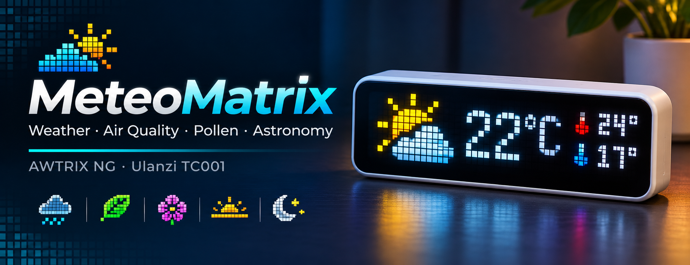

# MeteoMatrix — Weather, Air Quality & Astronomy for AWTRIX NG

[English](README_EN.md) · [Polski](docs/PL.md)

MeteoMatrix is a planned open-source, location-configurable weather and environment application for **AWTRIX NG** and **Ulanzi TC001 (32×8)**, derived from the original **SieradzMeteo v1.6** project.

> **Status: development preview. No **stable** installable Berry (.ax) release has been published.**

## Scope
- Weather, feels-like temperature, precipitation, wind, cloud cover and pressure.
- European air quality index, PM2.5, PM10 and seasonal pollen.
- Sunrise/sunset, moonrise/moonset and moon phase.
- Approved original pixel-art icons and animated rise/set scenes.
- Hide agreed zero-valued measurements (temperature always shown).
- Configurable latitude, longitude, timezone and Polish/English display language.
- Open-Meteo as the data source.
- Versioned GitHub releases, verified installer and reversible updates **after device API testing**.

Sieradz (51.590748, 18.736974, Europe/Warsaw) is a sample configuration only; no private LAN address or API credentials are part of the project.

## Roadmap
1. Import and verify the actual SieradzMeteo Berry code and its approved artwork.
2. Make location and language configurable without changing visual behavior.
3. Validate firmware settings and installation endpoints on AWTRIX NG.
4. Implement backup, integrity verification and rollback.
5. Test on TC001, then publish versioned release assets and installation instructions.

## Documentation
- [Polska dokumentacja](docs/PL.md)
- [English guide](README_EN.md)
- [Development and release policy](docs/DEVELOPMENT.md)
- [Changelog](CHANGELOG.md)

No license is included at this stage; publishing source does not yet grant permission to redistribute or modify it. The license will be selected before the first public installable release.

Not affiliated with AWTRIX NG or Open-Meteo.


## Visual overview


**Features at a glance:** weather, temperature, air quality, pollen, Sun and Moon, configurable location.


**Architecture:** Open-Meteo APIs → Berry script → AWTRIX NG display. These are feature illustrations, not screenshots of a released device build.

**Hero artwork:** the approved photorealistic TC001 banner is retained separately until its original PNG can be uploaded unchanged. It will not be replaced with an imitation.


## Source and development installer

The exact preserved **SieradzMeteo v1.6** reference is at [src/legacy/SieradzMeteo_v1_6.ax](src/legacy/SieradzMeteo_v1_6.ax). The [MeteoMatrix Berry development source](src/MeteoMatrix.ax) adds editable **latitude, longitude and timezone** through AWTRIX NG `@config` while retaining the original pixel-art bitmap table. It is **maintainer-confirmed working on TC001**, now includes a PL/EN display-language switch (maintainer-confirmed on TC001) and includes the recovered v1.6 astronomy animations (untested on device).

A standard-library Python [backup-first installer](tools/meteomatrix.py) and [Polish](docs/INSTALL_PL.md) / [English](docs/INSTALL_EN.md) installation instructions are provided **for controlled development testing only**. Nothing changes on an AWTRIX device unless `--apply` is specified.

```bash
python3 -m unittest discover -s tests -v
python3 tools/meteomatrix.py status --host YOUR_AWTRIX_IP
python3 tools/meteomatrix.py install --host YOUR_AWTRIX_IP
```


### Recovered original v1.6

The full original [SieradzMeteo v1.6](src/legacy/SieradzMeteo_v1_6.ax) (26 pages, animated Sun/Moon events and lunar phase) was recovered from the project's Library and committed unchanged. The development [MeteoMatrix source](src/MeteoMatrix.ax) now derives from **v1.6** rather than v1.5. Its original pixel-art and event animation routines were retained. Configuration/translation and Berry compatibility still require real-device verification.


### Device validation status

- **SieradzMeteo v1.6 (original): verified by the maintainer as working on a physical Ulanzi TC001 / AWTRIX NG.** This is the reference implementation.
- **MeteoMatrix development adaptation: maintainer-confirmed installed and working on a physical Ulanzi TC001. Installer update/restore flows have not been separately confirmed.** Its configurable location, PL/EN switching and update workflow require separate verification before a stable release.


**Hardware milestone (2026-11-18):** The maintainer confirms that the universal MeteoMatrix app is installed and running successfully on Ulanzi TC001. This establishes basic runtime operation, not that every locale, parameter, installer update or rollback pathway has been tested.


### Installation verification — maintainer report (2026-11-19)

Both installation methods have been confirmed successful on a Ulanzi TC001 running AWTRIX NG:

- Installation using the MeteoMatrix Python installer.
- Installation using the AWTRIX NG web interface.

These confirmations apply to **installation and application startup**, not yet to an **upgrade over an existing version**, backup restoration or rollback. Those remain separate release-qualification checks.
