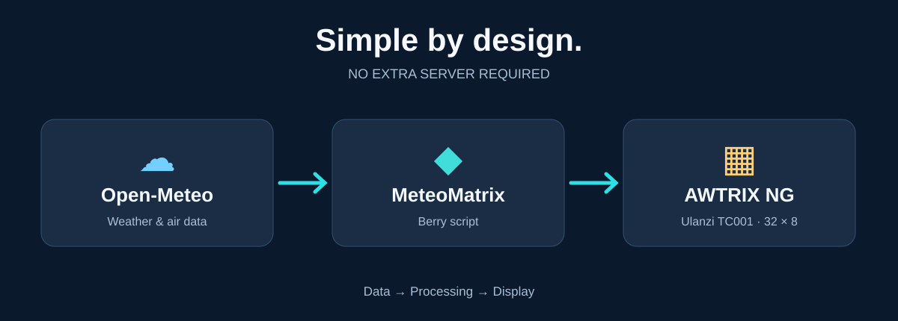

# MeteoMatrix — Weather, Air Quality & Astronomy for AWTRIX NG

[English](README_EN.md) · [Polski](docs/PL.md)

MeteoMatrix is a location-configurable weather and environment application for **AWTRIX NG** and **Ulanzi TC001 (32×8)**, derived from the original **SieradzMeteo v1.6** project.

> **Latest version: [v1.0.0-rc1](https://github.com/sp7uto/awtrix-meteomatrix/releases/tag/v1.0.0-rc1) — published release candidate. Verified working on TC001 by the maintainer; upgrade and rollback remain to be checked.**

## Scope
- Weather, feels-like temperature, precipitation, wind, cloud cover and pressure.
- European air quality index, PM2.5, PM10 and seasonal pollen.
- Sunrise/sunset, moonrise/moonset and moon phase.
- Approved original pixel-art icons and animated rise/set scenes.
- Hide agreed zero-valued measurements (temperature always shown).
- Configurable latitude, longitude, timezone and Polish/English display language.
- Open-Meteo as the data source.
- Versioned GitHub prerelease with a downloadable Berry script and checksum; installer supports backups and manual restore (upgrade/rollback verification pending).

Sieradz (51.590748, 18.736974, Europe/Warsaw) is a sample configuration only; no private LAN address or API credentials are part of the project.

## Milestones
- [x] Preserve verified SieradzMeteo v1.6 and its original approved artwork.
- [x] Add configurable location, timezone and language.
- [x] Confirm working TC001 installations through Python and AWTRIX NG web UI.
- [x] Publish v1.0.0-rc1 with the Berry script and checksum.
- [ ] Independently test upgrade and restore/rollback on physical hardware.
- [ ] Publish a stable v1.0.0 after release qualification.

## Documentation
- [Polska dokumentacja](docs/PL.md)
- [English guide](README_EN.md)
- [Development and release policy](docs/DEVELOPMENT.md)
- [Changelog](CHANGELOG.md)

**License:** A redistribution license has not yet been selected. Public availability of the source does not automatically grant permission to redistribute or modify it. A license decision is required before presenting the project as open-source.

Not affiliated with AWTRIX NG or Open-Meteo.


## Visual overview


**Features at a glance:** weather, temperature, air quality, pollen, Sun and Moon, configurable location.



**Architecture:** Open-Meteo APIs → Berry script → AWTRIX NG display. These are feature illustrations, not screenshots of a released device build.

**Hero artwork:** the approved Ulanzi TC001 banner is included at the top of this README.


## Source and development installer

The exact preserved **SieradzMeteo v1.6** reference is at [src/legacy/SieradzMeteo_v1_6.ax](src/legacy/SieradzMeteo_v1_6.ax). The [MeteoMatrix Berry development source](src/MeteoMatrix.ax) adds editable **latitude, longitude and timezone** through AWTRIX NG `@config` while retaining the original pixel-art bitmap table. It is **maintainer-confirmed working on TC001**, includes a PL/EN label switch and retains v1.6 astronomy animations. Individual language and location combinations have not all been independently tested.

A standard-library Python [backup-first installer](tools/meteomatrix.py) and [Polish](docs/INSTALL_PL.md) / [English](docs/INSTALL_EN.md) installation instructions are provided for the public release candidate. Nothing changes on an AWTRIX device unless `--apply` is specified.

```bash
python3 -m unittest discover -s tests -v
python3 tools/meteomatrix.py status --host YOUR_AWTRIX_IP
python3 tools/meteomatrix.py install --host YOUR_AWTRIX_IP
```


### Recovered original v1.6

The full original [SieradzMeteo v1.6](src/legacy/SieradzMeteo_v1_6.ax) (26 pages, animated Sun/Moon events and lunar phase) was recovered from the project's Library and committed unchanged. The development [MeteoMatrix source](src/MeteoMatrix.ax) is based on **SieradzMeteo v1.6**. Its original pixel-art and event animation routines were retained. Non-default location and language combinations still require separate verification.


### Device validation status

- **SieradzMeteo v1.6 (original): verified by the maintainer as working on a physical Ulanzi TC001 / AWTRIX NG.** This is the reference implementation.
- **MeteoMatrix v1.0.0-rc1: maintainer-confirmed installed and working on Ulanzi TC001 via both installation methods.** Upgrades, rollback and alternate configuration combinations still need dedicated checks.


**Hardware milestone (2026-11-18):** The maintainer confirms that the universal MeteoMatrix app is installed and running successfully on Ulanzi TC001. This establishes basic runtime operation, not that every locale, parameter, installer update or rollback pathway has been tested.


### Installation verification — maintainer report (2026-11-19)

Both installation methods have been confirmed successful on a Ulanzi TC001 running AWTRIX NG:

- Installation using the MeteoMatrix Python installer.
- Installation using the AWTRIX NG web interface.

These confirmations apply to **installation and application startup**, not yet to an **upgrade over an existing version**, backup restoration or rollback. Those remain separate release-qualification checks.


## Latest published version

**[MeteoMatrix v1.0.0-rc1](https://github.com/sp7uto/awtrix-meteomatrix/releases/tag/v1.0.0-rc1)** — first public release candidate (pre-release). Download the versioned [Berry script](https://github.com/sp7uto/awtrix-meteomatrix/releases/download/v1.0.0-rc1/MeteoMatrix.ax) and [SHA-256 checksum](https://github.com/sp7uto/awtrix-meteomatrix/releases/download/v1.0.0-rc1/MeteoMatrix.ax.sha256). Installation by the Python tool and AWTRIX NG web UI has been verified by the maintainer on TC001. Update-in-place and rollback are not yet independently confirmed. See the [release notes](release/notes-v1.0.0-rc1.md).
