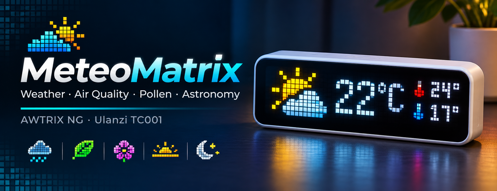

# MeteoMatrix — AWTRIX NG weather & environment dashboard

**Status: development preview. No installable Berry file is available yet.**

MeteoMatrix aims to turn the proven SieradzMeteo display into a customizable application for any location, initially targeting **AWTRIX NG on Ulanzi TC001 (32×8)**.

## Features in scope

Weather and apparent temperature, rain/snow, pressure, wind and cloud cover; European air quality (AQI, PM2.5, PM10); seasonal pollen; sunrise/sunset, moonrise/moonset and lunar phase. The original approved pixel-art icons and animations will be preserved. Agreed zero-valued parameters will be hidden, but temperature will always be displayed.

## Localization

Users will be able to configure latitude, longitude, timezone and display language (Polish or English) without editing the program. Sieradz, Poland, is only a sample setup.

## Delivery

Verified, tagged GitHub releases are planned, together with a backup-first update mechanism and rollback. The implementation and device API must be tested before an installation command is published.

See [English development notes](docs/EN.md), [Polish documentation](docs/PL.md), and [main README](README.md).

## Visual overview

These are conceptual illustrations of planned features, not screenshots of an installed release.

## Development sources and installer

- [Preserved original Berry source (v1.5)](src/legacy/SieradzMeteo_v1_5.ax)
- [MeteoMatrix .ax development adaptation](src/MeteoMatrix.ax) — configurable latitude, longitude and timezone, with original glyph table preserved
- [Installer (Python standard library)](tools/meteomatrix.py)
- [Development installation guide](docs/INSTALL_EN.md) and [Polish guide](docs/INSTALL_PL.md)

No hardware verification has been performed; bilingual display labels and the newer moon/sun animations are still pending. The installer defaults to a dry run and requires `--apply` for any write.
