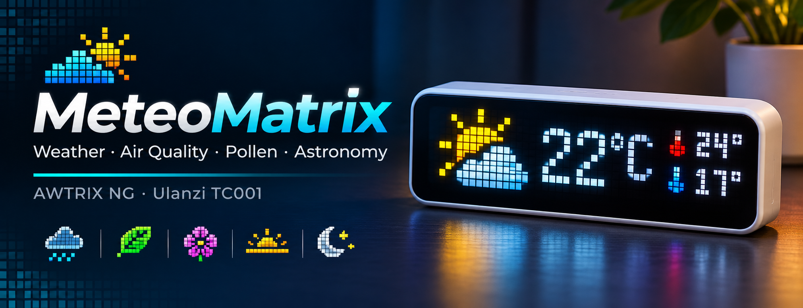
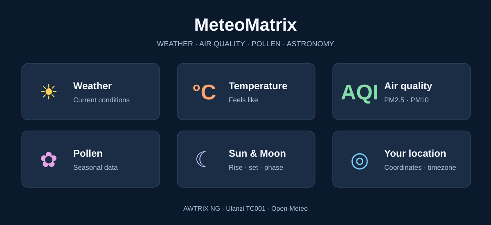

# MeteoMatrix — English documentation

## Current status

**[MeteoMatrix v1.0.0-rc1](https://github.com/sp7uto/awtrix-meteomatrix/releases/tag/v1.0.0-rc1) is published.** This is a public **release candidate**, not the final stable v1.0.0. It is based on the tested **SieradzMeteo v1.6**.

The maintainer has confirmed successful operation on a physical **Ulanzi TC001 / AWTRIX NG**, following installation **by both the Python installer and the AWTRIX NG web interface**. Upgrade-in-place and restoration/rollback still require separate device verification.

**[Download MeteoMatrix.ax](https://github.com/sp7uto/awtrix-meteomatrix/releases/download/v1.0.0-rc1/MeteoMatrix.ax)** · **[SHA-256 checksum](https://github.com/sp7uto/awtrix-meteomatrix/releases/download/v1.0.0-rc1/MeteoMatrix.ax.sha256)** · **[Bilingual release notes](../release/notes-v1.0.0-rc1.md)**

## Features

- 26 weather and environment screens.
- Current and feels-like temperature, precipitation, snowfall, wind, clouds and pressure.
- European AQI, PM2.5, PM10 and seasonal pollen readings.
- Sunrise and sunset, moonrise and moonset, current lunar phase.
- Preserved approved pixel-art icons and animated scenes from SieradzMeteo v1.6.
- Suppression of selected zero-valued readings (temperature remains visible).
- Configurable coordinates, IANA timezone and PL/EN text labels.

## Configuration

| Option | Example (Sieradz, Poland) |
| --- | --- |
| Latitude | `51.590748` |
| Longitude | `18.736974` |
| Timezone | `Europe/Warsaw` |
| Language | `pl` or `en` |

These values are defaults for the sample location, not required settings. Change them through the Berry app settings in AWTRIX NG.

## Installation and safety

Both installation paths are maintainer-confirmed: using the AWTRIX NG web UI to upload the `.ax` file, or using the repository's Python installer. See the [installation guide](INSTALL_EN.md).

The Python tool defaults to a non-writing check, requires explicit `--apply` to modify the device and backs up an existing script before updating it. **Upgrade/rollback have not yet been individually validated on the device.** The tool does not change firmware, Wi-Fi, MQTT or unrelated apps.

## Sources

- [MeteoMatrix Berry script](../src/MeteoMatrix.ax)
- [Tested SieradzMeteo v1.6 original](../src/legacy/SieradzMeteo_v1_6.ax)
- [Python installer](../tools/meteomatrix.py)
- [Developer guide](DEVELOPMENT.md)

## Visual overview

These are conceptual illustrations, not photographs of the running screen. Open-Meteo pollen coverage depends on region and season.

[Main README](../README.md) · [Polska dokumentacja](PL.md)
