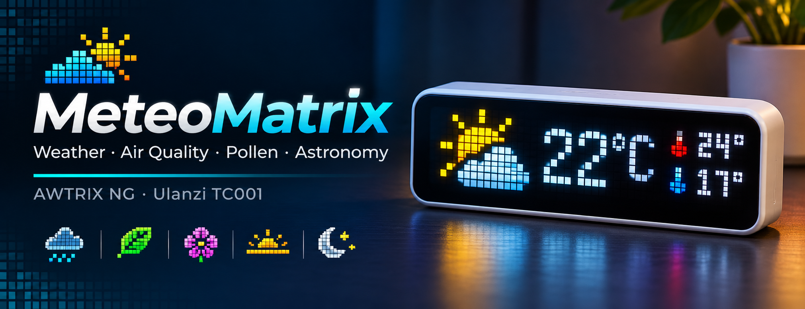

# MeteoMatrix

**Weather · Air Quality · Pollen · Sun & Moon**

A colorful weather and environment dashboard for **AWTRIX NG / Ulanzi TC001** with animated pixel art, customizable location and Polish/English labels.

**[Download latest release](https://github.com/sp7uto/awtrix-meteomatrix/releases/latest)** · **[Release v1.0.0-rc1](https://github.com/sp7uto/awtrix-meteomatrix/releases/tag/v1.0.0-rc1)** · **[Source code](https://github.com/sp7uto/awtrix-meteomatrix)**

## 🇵🇱 Dokumentacja po polsku

- [[Wprowadzenie|PL-Wprowadzenie]]
- [[Instalacja|PL-Instalacja]]
- [[Konfiguracja|PL-Konfiguracja]]
- [[Pogoda|PL-Pogoda]]
- [[Jakość powietrza i pyłki|PL-Jakosc-powietrza-i-pylki]]
- [[Słońce i Księżyc|PL-Slonce-i-Ksiezyc]]
- [[Rozwiązywanie problemów|PL-Pomoc]]

## 🇬🇧 English documentation

- [[Introduction|EN-Introduction]]
- [[Installation|EN-Installation]]
- [[Configuration|EN-Configuration]]
- [[Weather|EN-Weather]]
- [[Air quality and pollen|EN-Air-quality-and-pollen]]
- [[Sun and Moon|EN-Sun-and-Moon]]
- [[Troubleshooting|EN-Troubleshooting]]

## At a glance

- **26** weather and environmental screens
- Temperature, rain, snow, wind, pressure and cloud cover
- European air quality index, PM2.5, PM10 and seasonal pollen
- Animated sunrise, sunset, moonrise, moonset and lunar phase
- Original 8×8 pixel-art graphics
- Coordinates, timezone and PL/EN labels

MeteoMatrix is based on the verified **SieradzMeteo v1.6**. The current public release is **v1.0.0-rc1** (prerelease).
